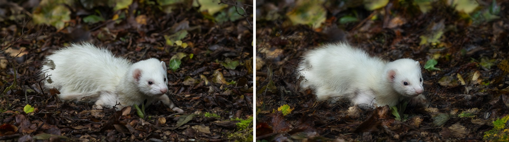
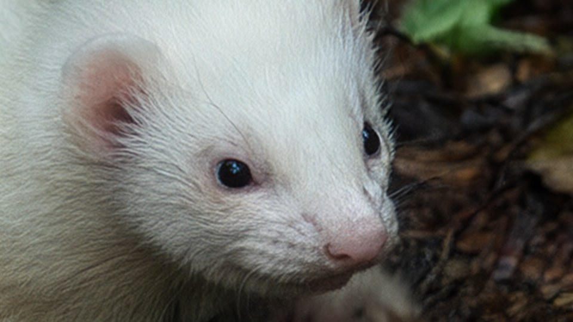
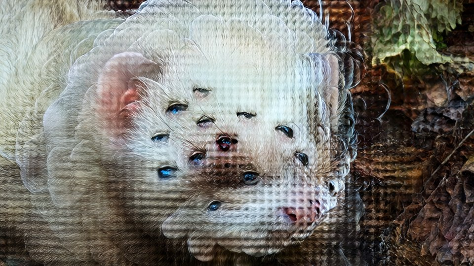
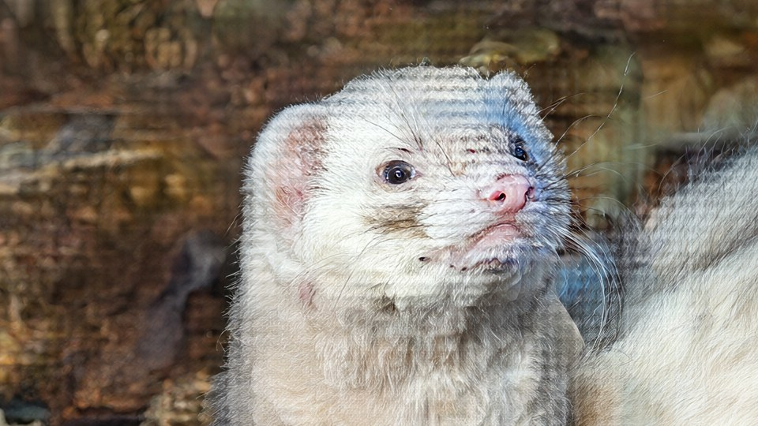

# ComfyUI-LowFrequencyGuide

**Iterate on composition at 720p in seconds, then render the *same* image natively at 4K.**


*Left: 1280×720 draft. Right: the 3840×2160 render, generated natively from noise and guided to keep the draft's composition. Both from Qwen-Image 2.1.*


*100% crop of the final. This is native-resolution detail, not an upscaler's guess.*

Two small nodes with no dependencies beyond what ComfyUI already ships:

- **Multiscale Seeded Noise.** One seed gives you noise for the final resolution plus a draft-resolution version that shares its low frequencies.
- **Low-Frequency Guide (ILVR).** A model patch that pins the coarse structure of the generation to your draft for the first part of sampling, then lets go.

---

## The problem

Modern models (Qwen-Image, Flux and friends) can generate at 4K directly, and the result is crisp. A render takes minutes, though, so you can't iterate on composition there. The obvious fix doesn't work: **the same seed at a different resolution gives a completely different picture.** A different resolution is a different dynamical system (token count, positional encodings, noise shift), not just a different starting point.

The usual workaround is to draft small and upscale. Every upscaling route I tried lost to a plain native 4K render:

| Route | What happens |
|---|---|
| Hires fix / img2img at 0.3–0.7 denoise | The model inherits the blur of the upscaled draft and faithfully renders a soft image at 4K. |
| Img2img at 1.0 denoise | Crisp, but the draft is ignored. At σ = 1 the latent is pure noise. |
| Tiled upscalers (USDU etc.) | Each tile loses global context; detail only gets added at the finest scale. |
| GAN upscalers | Wax. |

This isn't a tooling gap. Upscaling is an ill-posed inverse problem: the detail above the draft's Nyquist frequency doesn't exist, so it gets left empty (blur), averaged over all plausible options (wax), or sampled (new content). You can have **sharp, faithful, unchanged**: pick two.

So the useful definition of "the same image" is this: **the 4K render, downscaled, matches the draft.** Everything finer has to be generated, so it should be generated natively.

## How it works

```
seed ──► Multiscale Seeded Noise ──► noise_draft ──► draft sampler (1280×720) ──► preview
                                └──► noise_full ─┐            │
                                                 │            ▼
                                                 │   decode → lanczos to 3840×2160 → encode
                                                 │            │ (reference)
                                                 ▼            ▼
                                     4K sampler ◄── model + Low-Frequency Guide
```

**1. Shared noise.** The noise is always drawn at the final resolution. The draft gets the same tensor average-pooled by the scale factor and rescaled to unit variance, so it starts from exactly the low-frequency half of the 4K run's initial condition. On its own this already gives the same layout with entirely different details. That's handy for "same composition, new details" variations, but not enough for "same image".

**2. Low-frequency guide.** This is [ILVR](https://arxiv.org/abs/2108.02938), adapted to flow-matching models and applied to the model's clean-image prediction instead of the noisy latent. Each step, inside the active window:

```
x0' = x0 + w(σ) · strength · (LP(reference) − LP(x0))
```

`LP` is a Gaussian low-pass. The sampler integrates towards `x0'`, so the coarse band follows the draft while everything above the cutoff is generated natively. Working on x0 means there's no noise-level matching to get wrong. `w(σ)` eases the guide out (cosine, by default halfway through the schedule) so the model gets the second half to reconcile the details with the pinned layout.

## The two non-obvious bits

Getting the guide to work took three attempts. These are the parts you'd otherwise rediscover the hard way.

### Release the guide, or you summon a biblically accurate ferret



If the guide is held all the way to the end, the model and the guide fight. Each step the model places features (eyes, outlines) where its current state says they belong, then the guide drags the coarse band back, and the model re-places them. The fine band isn't reset between steps, so every placement leaves a residue. Releasing the guide partway, with a smooth falloff, fixes it completely. The original ILVR and DemoFusion both do something similar.

### Latent space isn't scale-linear: re-encode the reference at the target size



ILVR was designed for pixel-space models, where "low band of the 4K image" = "upscaled 720p image" holds exactly. A VAE latent pixel doesn't store a colour, though. It stores a description of an 8×8 pixel patch, including how much texture and edge energy is in it. A 720p latent pixel covers 3× more scene, so its channels say "lots of detail in here". Upscale that latent and pin the 4K low band to it, and the decoder must render 4K patches that satisfy those inflated texture-energy values. Its cheapest way to do that is a regular pattern at token pitch: the mesh above.

The fix is to give the guide a reference with genuine 4K-scale statistics: **decode the draft → upscale in pixel space (lanczos) → encode.** The mesh disappears entirely. (Bisected: guide off = clean; guide on with an upscaled-latent reference = mesh; guide on with a re-encoded reference = clean.)

## Install

Clone into `ComfyUI/custom_nodes/` and restart ComfyUI:

```bash
cd ComfyUI/custom_nodes
git clone https://github.com/agbogos/ComfyUI-LowFrequencyGuide
```

There's no `requirements.txt` because there's nothing to install: it only uses torch, which ComfyUI already has.

## Usage

Load [`example_workflows/draft_to_4k.json`](example_workflows/draft_to_4k.json). It's set up for Qwen-Image 2.1, so swap the loaders for your model.

1. **Mute the 4K group** (Ctrl+M) and change the seed on *Multiscale Seeded Noise* until the draft preview looks right. That takes seconds per try.
2. **Un-mute and queue.** The draft is cached, so only the 4K render runs.

Rules the workflow already follows:

- **Final size = draft size × factor, exactly**, so the pooled noise lines up (1280×720 × 3 = 3840×2160). Keep sizes multiples of 16.
- **Use a deterministic sampler** (`euler`) at **denoise 1.0** for both stages. Ancestral or SDE samplers inject fresh noise per step and decorrelate the two runs.
- Use **SamplerCustomAdvanced**, since that's the sampler node that accepts a custom noise source.
- The guide's **reference** is the draft re-encoded at the final size, as above.

The guide also works without the multiscale noise (core `RandomNoise` for the 4K run). The shared noise just gives it a head start.

## Node reference

### Multiscale Seeded Noise

| Input | Default | |
|---|---|---|
| `noise_seed` | 0 | The one seed for both stages. |
| `factor` | 3 | Final latent size ÷ draft latent size. |

Outputs `noise_full` (for the final render) and `noise_draft` (for the draft). Note that the noise differs from core `RandomNoise` for the same seed.

### Low-Frequency Guide (ILVR)

| Input | Default | |
|---|---|---|
| `reference` | | The draft, decoded, upscaled in pixel space, re-encoded. Other sizes are resized, but see the mesh section above. |
| `lowpass_factor` | 6 | Cutoff, in final-resolution latent pixels. Lower pins more, higher pins only the layout. |
| `strength` | 1.0 | Overall leash strength. |
| `start_percent` | 0.0 | Where in the schedule guidance starts. |
| `end_percent` | 0.5 | Where it has fully released. |
| `falloff` | cosine | `cosine`, `linear` or `constant` easing over the window. |

## Tuning

| Symptom | Try |
|---|---|
| Ghost features or duplicated outlines | Lower `end_percent` (0.35–0.4). |
| Composition drifts from the draft | Raise `end_percent` (0.6–0.7) or lower `lowpass_factor`. |
| Face or expression changes ("why is the ferret angry now") | Lower `lowpass_factor` to ~6. Expression lives at mid scale and becomes free at 10+. |
| Want more native reinterpretation (landscapes, textures) | Raise `lowpass_factor` to 8–10. |
| Mesh or grid pattern | The reference was upscaled in latent space. Re-encode it in pixel space. |
| Out of memory at 4K | Use VAE Encode/Decode (Tiled) for the 4K stage. |

If the 4K background comes out out-of-focus, check the draft first: it's almost certainly the model's own "animal photo = telephoto bokeh" prior, faithfully carried over. Prompt for depth of field if you want it sharp.

## Caveats

- Tested on **Qwen-Image 2.1** (int8) in ComfyUI over one morning. Nothing in the code is model-specific: it uses ComfyUI's generic post-CFG hook and the model's own latent format. Other flow-matching models (Flux etc.) should work but are untested.
- Your model has to be capable of native high-resolution generation in the first place. This guides a native render; it doesn't give a model abilities it lacks.
- It hooks ComfyUI internals (`set_model_sampler_post_cfg_function`, `model_sampling.percent_to_sigma`, `process_latent_in`), which could change in future ComfyUI versions.

## Prior art

- **ILVR:** Choi et al., *ILVR: Conditioning Method for Denoising Diffusion Probabilistic Models*, ICCV 2021. [arXiv:2108.02938](https://arxiv.org/abs/2108.02938). The core low-pass-replacement idea, in pixel space.
- **DemoFusion:** Du et al., CVPR 2024. [arXiv:2311.16973](https://arxiv.org/abs/2311.16973). Progressive upscaling with skip-residual guidance that decays over sampling.
- **[ComfyUI-FlowMatching-Upscaler](https://github.com/ttulttul/ComfyUI-FlowMatching-Upscaler):** progressive flow-matching upscaling for Qwen-Image. It's a different approach (staged partial denoise plus residual blending), worth a look if you want staged upscaling instead.

## License

[MIT No Attribution](LICENSE). Do whatever you want with it. Provided as is, with no warranty of any kind, express or implied, and no support promises. I'm not responsible for anything it does, including biblically accurate ferrets.

## Disclaimer

**Please don't ask for support.** I don't care for multimedia gen-AI much, so for me this was a "get it done quick" solution to a problem I had. The code, the maths and most of this README were written by Claude Opus 5.5 (Anthropic) over one morning of back-and-forth. My contribution was the idea, debugging, experimenting, and generating increasingly cursed ferrets until it worked.

I despise bloat, so I skipped the popular heavier, objectively superior upscaling solutions. While reading papers on this topic I found ILVR, which matched the intuition I already had, but couldn’t find a lightweight implementation of it, so... here we are.

As you can see, the example images aren't 1:1 exact matches down to the tiniest details. This is fine for me, and I found that with some fine-tuning of the parameters I could get reasonably close to the original. The workflow I had required rapid iteration on the composition and features, and for that this is perfect.

If ComfyUI changes its internals and this breaks, feed the traceback to an LLM. That's how it got built in the first place.
